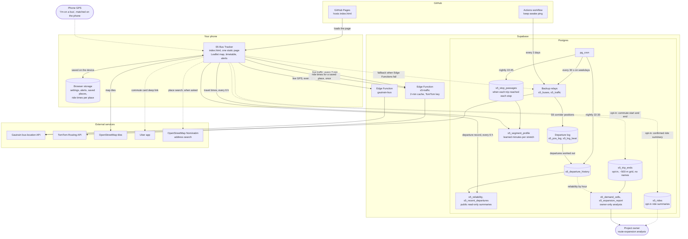

# S5 Bus Tracker

Never miss the Gautrain S5 bus between Sandton Station and Montecasino. Open it at
**https://ndu3000.github.io/s5-live/**.

An independent, open-source citizen project: not affiliated with or endorsed by the Gautrain Management Agency
or its operator SSM. No accounts, ads or trackers. See the [privacy notice](PRIVACY.md) (POPIA).

- **Live**: the next bus you can catch, when to leave, and where your bus really is (live GPS).
- **Route**: a live map of the S5 with every bus on it, plus the stop-by-stop list with times.
- **Timetable** and **Plan**: the weekday timetable from any stop, and "arrive by" / "leave after" planning.
- Alerts ring (sound, vibration, notification) when it's time to leave. Keep the page open on screen.
- **My commute** (turn it on in Settings): door to door with a ride (Uber/Bolt) to the S5, the S5 and the Gautrain,
  and back. You choose where the morning starts (first mile) and where the evening ends (last mile) from your saved
  places: add one by searching an address, pasting coordinates, or "Save where I am now".
- **I'm on a bus**: the app recognises which S5 bus you're on by matching your phone's location with the buses'
  GPS (on the phone; your location is never sent), asks you to confirm with one tap, then shows the next stop,
  your arrival and your train or ride connection. If location is off, pick your bus from a list. Optionally
  (asked once, or in Settings) the ride's summary is shared to improve arrival times: the bus, its departure,
  and the stops and times where the ride was confirmed and ended. Never the location, not linked to anyone.

How live GPS works:

- Positions come from Gautrain's bus-location feed every 10 seconds, through the relay in
  `relay/gautrain-bus/index.ts` (Supabase Edge Function in project `gautrain-s5-live`), which adds the
  headers browsers need.
- The feed doesn't say which route a bus is on. The app snaps each bus to the S5 road line, taking
  its direction into account, and pairs it with the nearest timetable trip.
- An early bus brings "leave by" forward. A late one only moves it back once the scheduled leave time has passed.
- Arrival estimates use TomTom's typical weekday traffic for each stretch of the route (sampled at ten times
  of day with TomTom routing, historical traffic). Each stretch's timetable minutes are scaled by how much slower or
  faster it is than its daily average, for live arrival times and for the "expected" times when live GPS
  can't see a bus. "Arrive by" plans pick a bus that typically makes it.
- Live traffic: `relay/s5-traffic/index.ts` (Supabase Edge Function, needs the `TOMTOM_API_KEY` secret) asks
  TomTom for the current driving time of every stretch, cached for 2 minutes. The app trusts it for the next
  15 minutes, blends back to typical traffic over the following 45, and names slow stretches.
- Backup routes: if the Edge Functions are unavailable, the app calls database functions on the same Supabase
  project through its REST API (`supabase/backup-relays.sql`). The TomTom key can be stored either as the
  `TOMTOM_API_KEY` Edge Function secret or in Supabase Vault as `tomtom_api_key`. A scheduled GitHub workflow
  calls the project every two days so Supabase doesn't pause it for inactivity.
- Departure log: on weekdays the Supabase project saves the S5 buses' GPS every 30 seconds and works out, for
  every timetabled departure from Montecasino and from Sandton Station, whether a bus left, how late, and when it
  arrived (`supabase/departure-log.sql`). The app warns when a departure has no bus on live GPS, and the timetable
  marks departures that often don't run or leave late (`public.s5_reliability`).
- Saved places stay on your phone. Their ride times to and from the S5 come from TomTom (typical weekday
  traffic) through the `s5-traffic` relay once per place, and are kept on the phone for 30 days.
- Help plan new routes (off by default, and only after agreeing on a consent screen; see [PRIVACY.md](PRIVACY.md)):
  shares where your commute starts and ends, snapped to a ~500 m grid,
  without names, under a random id, so demand can be mapped against the S5 (`supabase/trip-ends.sql`).
  Turning it off deletes what was shared. For the project owner, `select * from s5_expansion_report();` ranks
  where the S5 should grow: ~2 km zones by phones, distance to the nearest S5 stop and the kind of expansion
  (walkable, extra stop or detour, feeder or new route, with its direction), and departure hours by demand against
  the S5's frequency and reliability (add service, run more often, fix missing runs). Zones and hours with fewer
  than 3 phones are left out.
- Learned travel times (`supabase/eta-learning.sql`): each night the departure log's bus GPS gives the time every
  trip reached every stop (interpolated between reports at speed). `s5_segment_profile` turns that into the median
  minutes for each stretch by half hour (3+ trips on 2+ days), which the app uses in place of TomTom's typical car
  traffic, with live traffic applied as a change on top.
- Without a TomTom key, Gautrain's own buses are the traffic sensors: each S5 bus's progress over the last 3-6
  minutes, against what the timetable expects in typical traffic, sets a live factor for the stretches it drove
  (kept for 15 minutes).
- The route line and stop positions come from OpenStreetMap route relation 3281475, and the map tiles are
  OpenStreetMap's (© OpenStreetMap contributors, ODbL).

## Architecture

## Architecture decisions

Each decision records what we chose, why, and what it costs.

**ADR 1: One static HTML file on GitHub Pages.**
The whole app is `index.html`: HTML, CSS and JavaScript, with no build step and no framework.
*Why:* it loads fast on a phone over mobile data, is free to host, deploys with a `git push`, and anyone can read
or fix it in one place. *Cost:* the file is large and has no module boundaries, so tests drive it through a
headless browser (Playwright) rather than unit tests.

**ADR 2: Supabase Edge Functions relay the Gautrain feed.**
Gautrain's bus-location API doesn't send the CORS headers a browser needs, so the page can't call it directly.
*Why Supabase:* one free project gives serverless functions, Postgres, scheduled jobs (pg_cron), outbound HTTP
from SQL and secret storage, so the relay, the TomTom key and the departure log live together. *Cost:* free
projects pause after a week without traffic, hence the GitHub Actions keep-awake ping.

**ADR 3: Backup relays in the database.**
`s5_buses()` and `s5_traffic()` fetch the same data from inside Postgres (`http` extension). The app falls back
to them through the REST API whenever an Edge Function fails.
*Why:* Edge Functions and the database fail independently, so live GPS survives an Edge outage. *Cost:* two
copies of each relay to keep in step.

**ADR 4: The app works out which buses are S5 buses.**
The feed's route code is empty, so each bus is snapped to the S5 road line from OpenStreetMap (relation 3281475),
checked against its direction of travel, and paired with the nearest timetable trip.
*Why:* it is the only signal available. *Cost:* near Sandton Station the S5 shares roads with other routes, so a
bus there can't be told apart for its first few minutes, and a bus waiting at Montecasino can be paired with the
wrong slot. The departure log measures how often that happens.

**ADR 5: TomTom for traffic, with the key kept on the server.**
Typical weekday traffic (TomTom historical routing at ten times of day) is built into the page. Live traffic
comes from `s5-traffic`, which holds the API key and caches answers for 2 minutes.
*Why:* TomTom's routing gives a time for each stretch between stops; the key never reaches the browser; the
cache keeps use far inside the free tier (about 150 requests on a normal day). *Fallback:* without a key, the
S5 buses themselves act as traffic sensors.

**ADR 6: Leaflet with OpenStreetMap tiles.**
*Why:* no API key, no billing, small enough for one page, and the route geometry comes from OSM anyway.
*Cost:* the tiles are darkened with a CSS filter rather than a purpose-made dark style.

**ADR 7: A departure log in Postgres, run by pg_cron.**
Every 30 seconds on weekdays (05:00–22:20) the database saves the GPS of buses in the S5 corridor. It keeps one
row per stop or movement, so a parked bus doesn't add a row each tick. From those rows it works out every
departure from both terminals: whether a bus left, how late, its trip before, and when it arrived. Each night it
saves the result and deletes raw positions older than 30 days.
*Why:* a single live snapshot can't say whether a bus ran; only a history can. Doing it in the database means
nothing has to stay running on a phone or a server. *Safeguards:* `s5_log_beat` records when the feed actually
sent new positions, so a gap in Gautrain's feed shows as "no data" rather than "did not run". Only
`s5_reliability` (a per-departure summary) can be read publicly.

**ADR 8: Personal data stays on the device by default.**
Saved places, commute settings and alerts are stored in the browser (`localStorage`). Nothing about a person is
hard-coded: places are added in Settings or through a private setup link (`#commute=1&place=Home@lat,lon&from=Home&to=Home`),
which removes itself from the address bar. *Why:* the repository and the site are public. *Cost:* settings don't
follow you to another device. The only exceptions are the ride-time lookup (ADR 10) and opt-in sharing (ADR 11).

**ADR 9: Alerts run in the page, without push notifications.**
Alerts use sound, vibration, a system notification and a screen wake lock while the page is open.
*Why:* push notifications would need user accounts and a push service, which is too much for a single-route
tracker. *Cost:* the page has to stay open on screen for an alert to ring.

**ADR 10: First and last mile from saved places, with TomTom ride times.**
The commute card plans a ride from any saved place to the S5 and from the S5 to any saved place, instead of one
home point. Each place's driving times (five times of day each way, typical weekday traffic) are asked from
TomTom once, through `s5-traffic`, and kept on the phone for 30 days; until then the card shows a labelled
estimate from the distance. *Why:* times that match the place and the time of day, with the TomTom key kept on
the server. *Privacy:* the place travels in the request body (request logs only record the URL), and the relay
stores nothing. *Cost:* 10 TomTom requests per new place. Address search uses OpenStreetMap's Nominatim: free,
no key, and only when the user taps Search.

**ADR 11: Opt-in, coarse trip ends for route-expansion analysis.**
To see where people travel from and where new routes, extra stops or feeder services would help, the app can
share each commute's start and end. It does so only with "Help plan new routes" switched on (off by default), and
only after the person agrees on a consent screen that says what is and isn't shared, who sees it, why, and for how
long, with "I'm 18 or older" ticked. "Not now" is as easy as "Agree". The server refuses entries that don't carry
the current privacy notice's date (`consent_version`), so if the notice changes, people are asked again.
Unrefreshed entries are deleted after 12 months (the app refreshes active ones monthly).
The phone snaps each point to a ~500 m grid and sends no names. Each phone has one row per trip end under a
random id, updated in place, so there is no movement history. Switching it off deletes the rows. The public can
write and delete only. The project owner alone can read `s5_demand_cells` (phones per cell, usual start time,
distance to the nearest S5 stop) and `s5_expansion_report()`, which turns them into ranked suggestions: where a
stop, detour, feeder or new route would serve the most people, and which hours need more, earlier or more
reliable service (using the departure log). Groups smaller than 3 phones are left out. *Why:* demand data for planning with the least personal data that still
answers the question; a 500 m cell is enough to compare against a bus stop's walking catchment. *Cost:* only
people who opt in are counted, so the map shows relative demand, not totals.

**ADR 12: Recognising your bus on the phone, confirmed with one tap.**
While "I'm on a bus" runs (after a tap, or around the commute's own bus if location is already allowed), the
phone's GPS is compared with each S5 bus's GPS reports. Each report is compared with where the phone was *at the
report's time*, because the feed can be a minute behind. Three reports in a row within ~60 m (plus GPS error)
make a candidate; the person confirms or says No. The ride ends at the last stop, after two reports more than
300 m from the bus, or on "I got off". *Why:* the most accurate signal a web app has. Browsers don't offer the
phone's "in a vehicle" detection, and the walk-beside or car-behind cases fall out within a few reports, so the
tap settles the rest. *Privacy:* all on the phone; nothing is sent. *Cost:* GPS uses battery and only works with
the page open, so it stops after 25 minutes without a match. Tested against a real ride (bus 32993, 26 Oct).

**ADR 13: Arrival estimates learn from the buses' own recorded trips.**
TomTom's typical traffic describes cars. The S5 also queues out of the Montecasino terminal, stops and turns. On
Monday 26 October the first kilometre took buses 8–12 minutes at 07:00–07:30 against the timetable's 3, and the
whole trip took 18 minutes at 05:10 but 51 at 07:17. So the departure log's GPS is turned into the time each trip
reached each stop, and the median per stretch and half hour (3+ trips on 2+ days) replaces the typical-traffic
factor; live traffic still adjusts it. *Why:* it measures exactly what riders experience, it is Gautrain's bus data,
not anyone's, and it improves every day the log runs. *Safeguards:* two days minimum, so one bad day can't set it;
TomTom remains the fallback where there are too few trips. Rides confirmed by riders (opt-in, anonymous) are kept
separately, to check which bus ran which departure.

**ADR 14: A bus keeps the departure it left as.**
The feed gives each bus's position, not which timetabled departure it is running, so the app pairs them. Pairing
each bus with the departure its lateness fits best broke in the morning queue. On Tuesday 27 October bus 33002
left Montecasino at 07:40 as the 07:37, then took 12 minutes to cover the first kilometre, so by 07:51 it "fitted"
the 07:47 better and was relabelled, with a rider on board. Now a bus seen leaving Montecasino keeps that
departure until it is back at the terminal or turns round. The pairing is saved on the phone for the day, and
`s5_recent_departures` (departures in the departure log's last two hours: bus numbers and times only) covers an app
opened mid-trip. The remaining buses are paired together in road order, so a bus further along is always running an
earlier departure, and each keeps its previous departure unless another fits clearly better. *Why:* a departure is
a fact once the bus leaves, and lateness that grows is the information riders need, not a reason to relabel the bus.
*Tested* against the GPS of buses 33002 and 33011 that morning.

**ADR 15: Arrival-time methods are compared by backtest before they ship.**
`supabase/backtest.sql` (owner only) replays every trip in `s5_stop_passages`. From each stop a trip passed, it
predicts the time to every later stop the way each method would have at that moment, then compares with when the
bus really got there. Learned medians come only from other days, so no method sees the answer. *Why:* a change to
the arrival times should be measured, not guessed. *First run (23, 26 and 27 Oct; 200 trips, 25,606 predictions;
average error for trips 10–20 min ahead):*
- timetable: 6.4 min
- TomTom typical traffic: 6.4 min
- the app's learned medians: 5.4 min (with 3 days they cover only 0–31% of stretches)
- the buses ahead on the same stretch in the last 40 min: 2.5 min (53% of predictions within 2 min, against 18% for
  the app)

Live TomTom traffic isn't logged, so it can't be scored yet.
