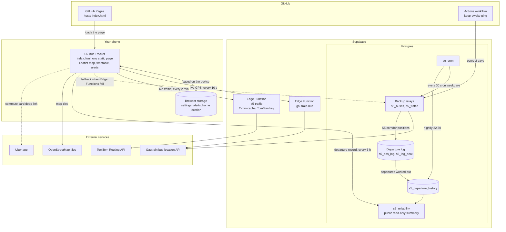

# S5 Bus Tracker

Never miss the Gautrain S5 bus between Sandton Station and Montecasino. Open it at
**https://ndu3000.github.io/s5-live/**.

- **Live**: the next bus you can catch, when to leave, and where your bus really is (live GPS).
- **Route**: a live map of the S5 with every bus on it, plus the stop-by-stop list with times.
- **Timetable** and **Plan**: the weekday timetable from any stop, and "arrive by" / "leave after" planning.
- Alerts ring (sound, vibration, notification) when it's time to leave. Keep the page open on screen.

How live GPS works:

- Positions come from Gautrain's bus-location feed every 10 seconds, through the relay in
  `relay/gautrain-bus/index.ts` (Supabase Edge Function in project `gautrain-s5-live`), which adds the
  headers browsers need.
- The feed doesn't say which route a bus is on. The app snaps each bus to the S5 road line, taking
  its direction into account, and pairs it with the nearest timetable trip.
- An early bus brings "leave by" forward. A late one only moves it back once the scheduled leave time has passed.
- Arrival estimates use TomTom's typical weekday traffic for each stretch of the route (sampled at ten times
  of day with TomTom routing, historical traffic). Each stretch's timetable minutes are scaled by how much slower or
  faster it is than its daily average, for live arrival times and for the "expected" times when live GPS
  can't see a bus. "Arrive by" plans pick a bus that typically makes it.
- Live traffic: `relay/s5-traffic/index.ts` (Supabase Edge Function, needs the `TOMTOM_API_KEY` secret) asks
  TomTom for the current driving time of every stretch, cached for 2 minutes. The app trusts it for the next
  15 minutes, blends back to typical traffic over the following 45, and names slow stretches.
- Backup routes: if the Edge Functions are unavailable, the app calls database functions on the same Supabase
  project through its REST API (`supabase/backup-relays.sql`). The TomTom key can be stored either as the
  `TOMTOM_API_KEY` Edge Function secret or in Supabase Vault as `tomtom_api_key`. A scheduled GitHub workflow
  calls the project every two days so Supabase doesn't pause it for inactivity.
- Departure log: on weekdays the Supabase project saves the S5 buses' GPS every 30 seconds and works out, for
  every timetabled departure from Montecasino and from Sandton Station, whether a bus left, how late, and when it
  arrived (`supabase/departure-log.sql`). The app warns when a departure has no bus on live GPS, and the timetable
  marks departures that often don't run or leave late (`public.s5_reliability`).
- Without a TomTom key, Gautrain's own buses are the traffic sensors: each S5 bus's progress over the last 3-6
  minutes, against what the timetable expects in typical traffic, sets a live factor for the stretches it drove
  (kept for 15 minutes).
- The route line and stop positions come from OpenStreetMap route relation 3281475, and the map tiles are
  OpenStreetMap's (© OpenStreetMap contributors, ODbL).

## Architecture

## Architecture decisions

Each decision records what we chose, why, and what it costs.

**ADR 1: One static HTML file on GitHub Pages.**
The whole app is `index.html`: HTML, CSS and JavaScript, with no build step and no framework.
*Why:* it loads fast on a phone over mobile data, is free to host, deploys with a `git push`, and anyone can read
or fix it in one place. *Cost:* the file is large and has no module boundaries, so tests drive it through a
headless browser (Playwright) rather than unit tests.

**ADR 2: Supabase Edge Functions relay the Gautrain feed.**
Gautrain's bus-location API doesn't send the CORS headers a browser needs, so the page can't call it directly.
*Why Supabase:* one free project gives serverless functions, Postgres, scheduled jobs (pg_cron), outbound HTTP
from SQL and secret storage, so the relay, the TomTom key and the departure log live together. *Cost:* free
projects pause after a week without traffic, hence the GitHub Actions keep-awake ping.

**ADR 3: Backup relays in the database.**
`s5_buses()` and `s5_traffic()` fetch the same data from inside Postgres (`http` extension). The app falls back
to them through the REST API whenever an Edge Function fails.
*Why:* Edge Functions and the database fail independently, so live GPS survives an Edge outage. *Cost:* two
copies of each relay to keep in step.

**ADR 4: The app works out which buses are S5 buses.**
The feed's route code is empty, so each bus is snapped to the S5 road line from OpenStreetMap (relation 3281475),
checked against its direction of travel, and paired with the nearest timetable trip.
*Why:* it is the only signal available. *Cost:* near Sandton Station the S5 shares roads with other routes, so a
bus there can't be told apart for its first few minutes, and a bus waiting at Montecasino can be paired with the
wrong slot. The departure log measures how often that happens.

**ADR 5: TomTom for traffic, with the key kept on the server.**
Typical weekday traffic (TomTom historical routing at ten times of day) is built into the page. Live traffic
comes from `s5-traffic`, which holds the API key and caches answers for 2 minutes.
*Why:* TomTom's routing gives a time for each stretch between stops; the key never reaches the browser; the
cache keeps use far inside the free tier (about 150 requests on a normal day). *Fallback:* without a key, the
S5 buses themselves act as traffic sensors.

**ADR 6: Leaflet with OpenStreetMap tiles.**
*Why:* no API key, no billing, small enough for one page, and the route geometry comes from OSM anyway.
*Cost:* the tiles are darkened with a CSS filter rather than a purpose-made dark style.

**ADR 7: A departure log in Postgres, run by pg_cron.**
Every 30 seconds on weekdays (05:00–22:20) the database saves the GPS of buses in the S5 corridor. It keeps one
row per stop or movement, so a parked bus doesn't add a row each tick. From those rows it works out every
departure from both terminals: whether a bus left, how late, its trip before, and when it arrived. Each night it
saves the result and deletes raw positions older than 30 days.
*Why:* a single live snapshot can't say whether a bus ran; only a history can. Doing it in the database means
nothing has to stay running on a phone or a server. *Safeguards:* `s5_log_beat` records when the feed actually
sent new positions, so a gap in Gautrain's feed shows as "no data" rather than "did not run". Only
`s5_reliability` (a per-departure summary) can be read publicly.

**ADR 8: Personal data stays on the device.**
Your home location, commute settings and alerts are stored in the browser (`localStorage`). They are set
through Settings or a private setup link (`#commute=1&home=…`), which removes itself from the address bar.
*Why:* the repository and the site are public, so nothing personal goes into code, URLs or the database. *Cost:*
settings don't follow you to another device.

**ADR 9: Alerts run in the page, without push notifications.**
Alerts use sound, vibration, a system notification and a screen wake lock while the page is open.
*Why:* push notifications would need user accounts and a push service, which is too much for a single-route
tracker. *Cost:* the page has to stay open on screen for an alert to ring.
